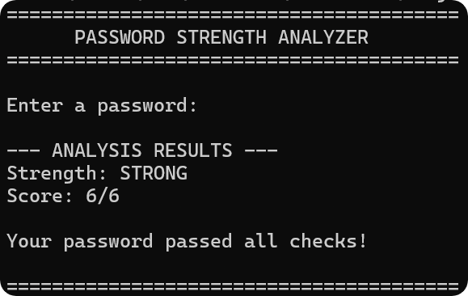
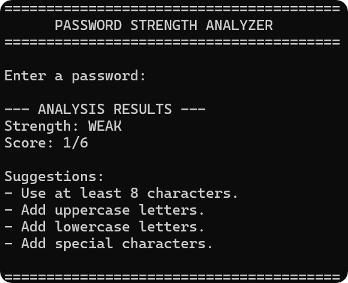

## Password Strength Analyzer

A simple Python project that evaluates the strength of a password entered by the user using a score-based system. The analyzer considers password length, character variety, and common-password detection, including passwords such as "password123".

<p align="center">
  
  
</p>

## Features

- **Length analysis**
- **Uppercase letters**
- **Lowercase letters**
- **Numbers**
- **Special characters**
- **Commonly used passwords**

## Technologies

- **Python 3.x**
- **string** (`import string`)
- **getpass** (`import getpass`)

## Installation

Clone the repository:

```bash
git clone https://github.com/Ryoeh/password-strength-analyzer.git
```

Navigate to the project directory:

```bash
cd password-strength-analyzer
```

## Usage

Run the program using:

```bash
python main.py
```

Enter a password, and the analyzer will score it and provide tips to improve password strength.

## Scoring System

| Criteria | Points |
|:---|---:|
| At least 12 characters | 2 |
| At least 8 characters | 1 |
| Any uppercase letters | 1 |
| Any lowercase letters | 1 |
| Any numbers | 1 |
| Any special characters | 1 |

## Ranking

| Ranking | Score |
|:---|---:|
| Weak | 0 - 2 |
| Medium | 3 - 4 |
| Strong | 5 - 6 |

## Limitations

- The project only checks six criteria, so it is not exhaustive.
- A high score does not guarantee an uncrackable password.
- The scores and rankings do not estimate real-world strength or immunity from attacks.

## Future Improvements

- Check for repeated characters
- Create a more complete ranking system
- Provide better tips for improving password security
- Include more criteria and a wider score range
